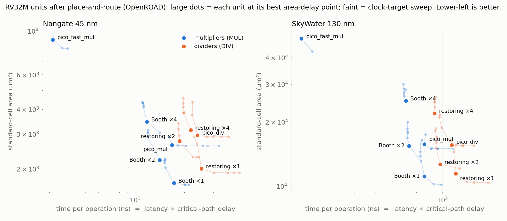
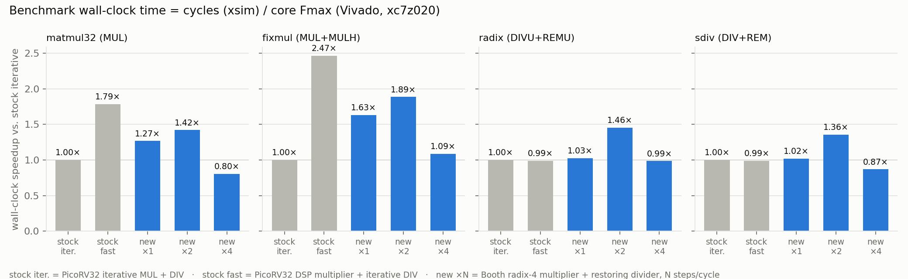

# RV32M_Arith_PPA

Design-space exploration of RISC-V **M-extension** (multiply/divide) hardware for the
[PicoRV32](https://github.com/YosysHQ/picorv32) core: a new **radix-4 Booth multiplier** and a
**restoring divider**, each parameterised to retire 1, 2 or 4 steps per clock, compared against
PicoRV32's own three M units on

- **correctness:** a reference-model unit testbench with mutation tests, and the official riscv-tests on the full core;
- **performance:** cycle-accurate benchmarks that each stress one instruction class;
- **FPGA PPA:** Vivado place-and-route on a Zynq-7020 (xc7z020clg400-1);
- **ASIC PPA:** full RTL-to-GDS in OpenROAD-flow-scripts on **Nangate 45 nm** and **SkyWater 130 nm**.

## Units under test

| unit | source | algorithm | latency (cycles) |
|---|---|---|---|
| `pico_mul` | PicoRV32 `ENABLE_MUL` | iterative shift-and-add | 36 (MUL), 68 (MULH/MULHSU/MULHU) |
| `pico_fast_mul` | PicoRV32 `ENABLE_FAST_MUL` | single 33×33 multiply | 2 |
| `booth_d1/d2/d4` | `rtl/pcpi_mul_booth.v` | radix-4 Booth, 1/2/4 digits per cycle | 18 / 10 / 6 |
| `pico_div` | PicoRV32 `ENABLE_DIV` | iterative shift-subtract | 36 |
| `restoring_b1/b2/b4` | `rtl/pcpi_div_restoring.v` | restoring, 1/2/4 bits per cycle (radix 2/4/16) | 33 / 17 / 9 |

Latencies are measured by the testbench (`pcpi_valid` to `pcpi_ready`).

The Booth unit extends both operands to 34 bits, which turns MUL, MULH, MULHSU and MULHU into
one signed multiply of 17 Booth digits. The divider works on magnitudes and fixes the signs at
the end. The RISC-V divide-by-zero and overflow results fall out of the algorithm, apart from
one guard: the all-ones quotient of a signed divide by zero must not be negated.

## Verification

| check | result |
|---|---|
| Unit testbench (`sim/tb_unit.v`): 16×16 corner-value pairs × 4 instructions + 20,000 random operations, against an RV32M reference model; also checks PicoRV32's 16-cycle `pcpi_wait` timeout rule | **all 9 units pass 21,024 checks each** |
| Mutation testing: 12 realistic bugs injected one at a time (Booth ±2M digits, wrong carry digit, MULHSU signedness, high/low word select, divide-by-zero sign, remainder sign, missing restore step, short iteration count, missing `pcpi_wait`) | **12/12 caught (100%)** |
| Gate-level simulation of every **routed** netlist (both processes), 2,024 checks each, with flip-flops starting at X, at 0 and at 1 | **18/18 netlists pass** with any defined power-up state (one X-start case is simulator X-pessimism, explained below) |
| Full core (`sim/tb_soc.v`): 45 riscv-tests (37 rv32ui + 8 rv32um) | **45/45 on all 5 core configurations** |
| Benchmark checksums against an independent Python model | all match |

Details: [`results/unit_tests.md`](results/unit_tests.md), [`results/system.md`](results/system.md),
[`results/signoff.md`](results/signoff.md).

## ASIC results (OpenROAD, post-route)



Every unit is taken through the full flow (Yosys → floorplan → placement → CTS → global and
detailed routing) at **seven clock targets per process**, with identical floorplan settings
and constraints. Each unit is then compared at **its own best area-delay point**. A single
shared target would favour some units: one that meets it with large slack is never pushed
by the tools.

**Nangate 45 nm**, each unit at its best-ADP target (sweep 0.35–2.5 ns):

| unit | best target (ns) | area (µm²) | Fmax (MHz) | latency | time/op (ns) | ADP (µm²·ns) |
|---|---:|---:|---:|---:|---:|---:|
| pico_mul | 0.5 | 2,634.5 | 2,146 | 36 | 16.8 | 44,205 |
| pico_fast_mul | 1.5 | 9,035.8 | 636 | 2 | 3.1 | **28,420** |
| booth_d1 | 1.0 | **1,689.9** | 1,043 | 18 | 17.3 | 29,175 |
| booth_d2 | 1.5 | 2,211.3 | 708 | 10 | 14.1 | 31,244 |
| booth_d4 | 2.0 | 3,456.4 | 508 | 6 | 11.8 | 40,803 |
| pico_div | 0.7 | 2,957.7 | 1,500 | 36 | 24.0 | 70,984 |
| restoring_b1 | 0.7 | **1,999.8** | 1,300 | 33 | 25.4 | **50,774** |
| restoring_b2 | 1.0 | 2,761.3 | 911 | 17 | 18.7 | 51,530 |
| restoring_b4 | 2.5 | 3,137.2 | 412 | 9 | 21.8 | 68,528 |

**SkyWater 130 nm**, each unit at its best-ADP target (sweep 1.5–9.0 ns):

| unit | best target (ns) | area (µm²) | Fmax (MHz) | time/op (ns) | ADP (µm²·ns) |
|---|---:|---:|---:|---:|---:|
| pico_mul | 2.0 | 15,720 | 460 | 78.3 | 1,230,314 |
| pico_fast_mul | 6.0 | 49,045 | 138 | 14.5 | **709,625** |
| booth_d1 | 4.5 | **11,107** | 230 | 78.2 | 868,795 |
| booth_d2 | 6.0 | 15,436 | 158 | 63.3 | 977,118 |
| booth_d4 | 9.0 | 25,093 | 99 | 60.6 | 1,520,591 |
| pico_div | 3.5 | 15,582 | 317 | 113.6 | 1,770,664 |
| restoring_b1 | 3.5 | 11,459 | 274 | 120.3 | 1,377,884 |
| restoring_b2 | 6.0 | 12,642 | 175 | 97.1 | **1,227,709** |
| restoring_b4 | 4.5 | 21,930 | 100 | 89.8 | 1,969,101 |

ADP = area × latency × (clock period − WNS). Latency is the MUL/DIV latency (`pico_mul` takes
68 cycles for MULH-type instructions, so the table flatters it). Every run of the sweep is in
[`results/orfs.md`](results/orfs.md).

- **The Booth ×1 multiplier is the smallest multiplier and has 1.5× lower ADP than PicoRV32's
  iterative multiplier** (1.42× on 130 nm), with constant 18-cycle latency for all four
  instructions instead of 36/68.
- **Booth ×1 is within 3% of the single-cycle `pico_fast_mul` on ADP at 45 nm while using 5.3× less
  area** (22% worse ADP and 4.4× less area on 130 nm). The array multiplier wins only when
  latency matters more than area.
- **The restoring divider has 1.4× lower ADP than PicoRV32's divider** on both processes
  (×1 at 45 nm, ×2 at 130 nm; the two are within 1.5% of each other at 45 nm) and is 32% smaller at ×1.
- **Unrolling has diminishing returns.** Each extra step per cycle chains another 33–36-bit
  carry-propagate adder into the critical path. Going to 4 steps per cycle makes ADP clearly worse for
  both units on both processes. Its critical path is about 50 cells deep, against 16 for Booth ×1.

### Physical sign-off data

For every unit at the common target (2.0 ns at 45 nm, 6.0 ns at 130 nm), `scripts/run_signoff.py`
extracts the data below from the routed design. Full tables: [`results/signoff.md`](results/signoff.md).

| unit (45 nm, 2.0 ns) | area synth → placed → routed (µm²) | setup WNS / hold WNS (ns) | CTS skew (ps) | busiest layer (GR usage) | signal metal (µm²) | logic depth | power (mW) | energy/op (pJ) |
|---|---|---|---:|---|---:|---:|---:|---:|
| pico_mul | 2,454 → 2,531 → 2,609 | +1.233 / +0.084 | 3.7 | metal2 31% | 632 | 5 | 1.52 | 190.9 |
| pico_fast_mul | 8,159 → 8,142 → 8,185 | +0.202 / +0.108 | 7.4 | metal2 47% | 3,538 | 20 | 1.93 | **19.3** |
| booth_d1 | 1,580 → 1,639 → 1,659 | +0.885 / +0.101 | 3.6 | metal2 41% | 625 | 16 | 1.07 | 44.9 |
| booth_d2 | 2,171 → 2,185 → 2,206 | +0.479 / +0.103 | 4.7 | metal2 46% | 1,042 | 24 | 1.39 | 36.2 |
| booth_d4 | 3,017 → 3,281 → 3,456 | +0.032 / +0.100 | 6.3 | metal2 48% | 1,796 | 50 | 2.04 | 36.7 |
| pico_div | 2,820 → 2,866 → 2,902 | +1.069 / +0.112 | 7.9 | metal2 39% | 1,064 | 9 | 1.39 | 108.4 |
| restoring_b1 | 1,847 → 1,886 → 1,905 | +0.786 / +0.104 | 5.4 | metal2 46% | 708 | 12 | 0.87 | 62.6 |
| restoring_b2 | 2,250 → 2,269 → 2,286 | +0.607 / +0.104 | 3.9 | metal2 43% | 1,018 | 22 | 1.05 | 42.0 |
| restoring_b4 | 3,036 → 3,661 → 3,835 | −0.207 / +0.105 | 5.0 | metal2 49% | 1,756 | 49 | 1.72 | 41.3 |

- **Routing:** every run has zero global-routing overflow. All runs are DRC-clean apart from one residual
  violation in the stock `pico_div` on 130 nm. Hold timing is met everywhere.
- **Area growth after placement** comes from timing repair: 448 and 832 repair buffers for the
  ×4 units, against 128–216 for the others. Routed signal metal per µm² of cells rises from 0.24
  (`pico_mul`) to 0.52 (`booth_d4`), so the unrolled datapaths are also the most wire-dominated.
- **Critical paths:** the iterative stock units are shallow (5–9 cells, dominated by control
  and counter logic). The new units' paths run through the adder: Booth ×1 is `m` → `h[34]`
  through one recoded 36-bit add (16 cells), and the ×4 versions chain four of them (about 50 cells).
- **Power and energy** come from simulating the routed netlist: 1,000 random operations, switching
  activity measured on every net (all but 2 nets per design annotated), with extracted parasitics in
  OpenSTA. **Booth ×1 uses 4.2× less energy per multiply than `pico_mul`, and restoring ×2
  uses 2.6× less energy per divide than `pico_div`.** The single-cycle `pico_fast_mul` has the lowest
  energy per operation of all units: it is large, but it is idle most of the time and finishes in 2 cycles.
- **Gate-level X check:** `booth_d2` on 45 nm reports one X on its first operation when every flip-flop
  powers up as X, and passes when they start at 0 or at 1. That signature is simulator X-pessimism: an
  uninitialised register is X-propagated through gates whose real output does not depend on it.
  Any real power-up state works, and the RTL simulation is correct.

## FPGA results (Vivado, Zynq-7020, out-of-context, best of 3 clock targets)

| unit | LUT | FF | DSP | Fmax (MHz) | time/op (ns) |
|---|---:|---:|---:|---:|---:|
| pico_mul | 225 | 255 | 0 | 414.9 | 86.8 |
| pico_fast_mul | 73 | 37 | 4 | 175.7 | 11.4 |
| booth_d1 | 217 | 110 | 0 | 230.6 | 78.1 |
| booth_d2 | 321 | 117 | 0 | 163.6 | 61.1 |
| booth_d4 | 533 | 116 | 0 | 105.8 | 56.7 |
| pico_div | 342 | 201 | 0 | 209.1 | 172.2 |
| restoring_b1 | 233 | 107 | 0 | 246.0 | 134.1 |
| restoring_b2 | 282 | 106 | 0 | 148.5 | 114.5 |
| restoring_b4 | 378 | 105 | 0 | 74.7 | 120.5 |

| core (PicoRV32 RV32IMC +) | LUT | FF | DSP | Fmax (MHz) |
|---|---:|---:|---:|---:|
| stock_seq: pico_mul + pico_div | 1,884 | 1,087 | 0 | 151.1 |
| stock_fast: pico_fast_mul + pico_div | 1,706 | 955 | 4 | 149.6 |
| booth1: booth_d1 + restoring_b1 | 1,729 | 854 | 0 | 146.4 |
| booth2: booth_d2 + restoring_b2 | 1,859 | 849 | 0 | 141.7 |
| booth4: booth_d4 + restoring_b4 | 2,201 | 851 | 0 | **73.7** |

On FPGA, `pico_fast_mul` maps onto four hard DSP48 multipliers, so its LUT count hides its real cost.
The ASIC flow, which has only standard cells, is the technology-neutral comparison.

## Benchmarks: cycles are not the whole story

| kernel | instructions | stock_seq | stock_fast | booth1 | booth2 | booth4 |
|---|---|---:|---:|---:|---:|---:|
| matmul32: 16×16 int32 matrix multiply | MUL | 312,363 | 173,099 | 238,635 | 205,867 | 189,483 |
| fixmul: 1,024 Q16.16 products | MUL + MULH | 171,061 | 68,661 | 101,429 | 85,045 | 76,853 |
| radix: 256 values printed in a run-time base | DIVU + REMU | 254,016 | 254,016 | 239,748 | 163,652 | 125,604 |
| sdiv: 1,024 signed quotient + remainder | DIV + REM | 126,003 | 126,003 | 119,859 | 87,091 | 70,707 |

Cycle counts from xsim, measured with `rdcycle`. Wall-clock time = cycles / core Fmax:



- **In cycles, `booth4` is the fastest design without DSPs:** radix 2.02× and sdiv 1.78× vs. stock.
  **In wall-clock time it is the slowest.** Its radix-16 divider chains four 33-bit subtractors
  (41 logic levels, 36 of them CARRY4) and halves the core clock to 73.7 MHz.
- **`booth2` is the best design without DSPs:** 1.36–1.89× faster than stock PicoRV32 on every kernel.
- `booth1` replaces both stock units with 155 fewer LUTs and 233 fewer flip-flops, at nearly
  the same clock.
- For multiply-heavy code on FPGA, the DSP-based `stock_fast` is still the fastest (fixmul 2.47×).

## Repository layout

```
rtl/      pcpi_mul_booth.v, pcpi_div_restoring.v, core_top.v (selectable M units)
sim/      tb_unit.v (unit testbench), tb_soc.v (full-core testbench)
sw/       riscv-tests harness, benchmark kernels, linker script, Makefile
scripts/  run_unit_tests.py, run_system.py, run_vivado.py + vivado_impl.tcl,
          run_orfs.py, run_signoff.py + vcd_activity.py + power_gls.tcl,
          make_plots.py, bin2hex.py
results/  all numbers above as .json/.md, plus the plots
```

## Reproducing

```sh
git clone https://github.com/YosysHQ/picorv32 third_party/picorv32   # tested at ef203c2
python3 scripts/run_unit_tests.py         # 9 units + 12 mutants (Vivado xsim)
python3 scripts/run_system.py             # riscv-tests + benchmarks on 5 cores
JOBS=6 python3 scripts/run_vivado.py      # FPGA implementation
JOBS=6 python3 scripts/run_orfs.py        # ASIC flow, 7-target sweep (needs OpenROAD-flow-scripts in $ORFS)
python3 scripts/run_signoff.py            # stage metrics, CTS, congestion, metal, GLS, power
python3 scripts/make_plots.py
```

Tools used: Vivado 2025.2 (xsim and implementation), the RISC-V GCC from Vitis 2025.2, and OpenROAD-flow-scripts.

## Notes and limitations

- FPGA numbers come from implementation reports (out-of-context, reg-to-reg); no board was used.
- ASIC Fmax is post-route (clock period − WNS). Two ×4 units have their best ADP at the loosest
  target of the sweep (restoring ×4 at 45 nm, Booth ×4 at 130 nm). A looser clock cannot raise Fmax,
  and their area is already close to the synthesis minimum, so their ADP cannot fall below about 65,000 and
  1,450,000 µm²·ns. They would still be the worst in their class.
- Sign-off data, gate-level simulation and power are taken at the common target per process. On
  130 nm, four units miss that 6.0 ns target, and their tables report the Fmax they reached.
- Power uses zero-delay gate-level activity, so glitch power is not included. Energy per operation
  includes the idle cycles the testbench leaves between operations, which is the same for every unit.
- One residual routing DRC remains in the stock `pico_div` on sky130hd; every other run is DRC-clean.
- PicoRV32 is not pipelined, so every multi-cycle operation stalls the core. In a pipelined
  core, part of this latency would overlap with independent instructions.

PicoRV32 is by Claire Xenia Wolf and is ISC-licensed. It is fetched separately and not included here.
